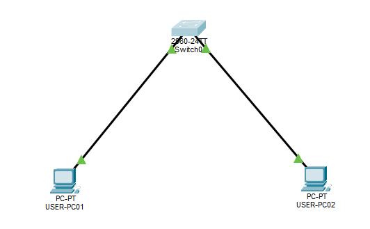
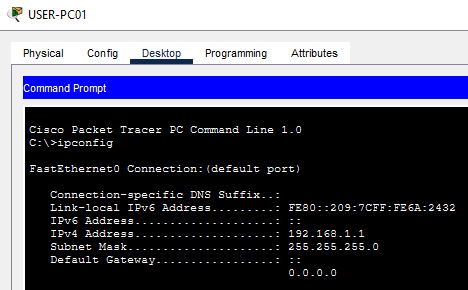
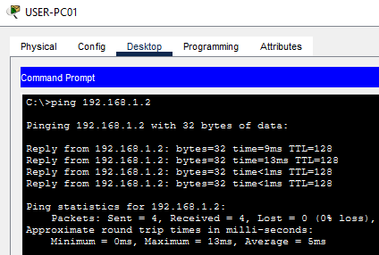
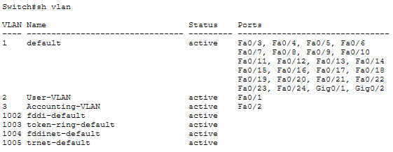
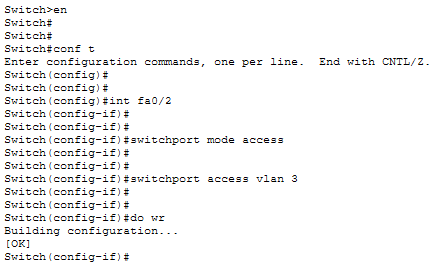
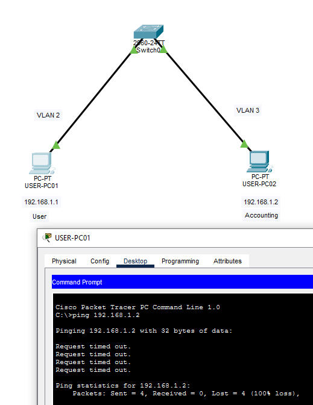
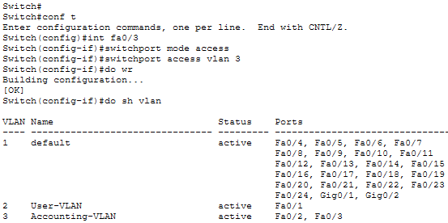

# Lab 01 — Basic Switch Configuration and VLAN Assignment

## Overview

This lab uses Cisco Packet Tracer to build a simple switched network and configure VLANs on a Cisco Catalyst 2960 switch. Three PCs connect to the switch, with one PC assigned to VLAN 2 and two PCs assigned to VLAN 3.

The lab demonstrates basic Cisco IOS CLI navigation, VLAN creation, access-port configuration, configuration saving, and connectivity verification.

## Objectives

- Build a basic switched network in Cisco Packet Tracer.
- Configure static IPv4 addresses on three PCs.
- Navigate Cisco IOS command modes.
- Create and name VLANs.
- Configure switch access ports and assign VLAN membership.
- Save the running configuration to startup configuration.
- Verify VLAN membership using Cisco IOS show commands.
- Test connectivity within and between VLANs.

## Lab Environment

| Component | Specification |
|---|---|
| Simulator | Cisco Packet Tracer |
| Switch | Cisco Catalyst 2960 |
| End devices | Three PCs |
| Switch interfaces | FastEthernet0/1, FastEthernet0/2, FastEthernet0/3 |
| Addressing | Static IPv4 |
| VLANs | VLAN 2 and VLAN 3 |

## Network Topology

The planned topology consists of one Cisco 2960 switch connected to three PCs.

| Device | Switch Port | IPv4 Address | Subnet Mask | VLAN |
|---|---|---|---|---|
| USER-PC01 — User | Fa0/1 | 192.168.1.1 | 255.255.255.0 | 2 |
| USER-PC02 — Accounting | Fa0/2 | 192.168.1.2 | 255.255.255.0 | 3 |
| USER-PC03 — Accounting | Fa0/3 | 192.168.1.3 | 255.255.255.0 | 3 |

No default gateway is required for the intended same-VLAN connectivity tests.

## Prerequisites

- Cisco Packet Tracer is installed.
- Basic familiarity with IPv4 addressing and subnet masks.

## Step 1 — Build the Topology

1. Added one Cisco Catalyst 2960 switch.
2. Added two PCs
3. Connected USER-PC01 to FastEthernet0/1.
4. Connected USER-PC02 to FastEthernet0/2.

> Note: The third PC will come later.

5. Used copper straight-through cables.
6. Waited for the connections to initialize.



## Step 2 — Configure PC IPv4 Addresses

For each PC:

1. Opened the PC.
2. Selected Desktop.
3. Opened IP Configuration.
4. Selected Static.
5. Entered an IP address and subnet mask.
6. Left the default gateway blank.

**Verification:** Opened cmd and ran ipconfig:




Verified connectivity by successfully pinging one PC from the other.



## Step 3 — Access the Switch CLI and Create VLANs

Opened the switch and selected the CLI tab.

Created VLAN 2 & 3 for Users and Accounting:

1. Entered `en` to access privileged mode and then `config t` to configure the terminal.
2. Typed `vlan 2` and named it **User-VLAN** → `Exit`.
3. Typed `vlan 3` and named it **Accounting-VLAN** → `Exit` → `Exit`.
4. Entered `sh vlan` to show the newly created vlans.



## Step 4 — Assign Ports to VLANs

Assigned each computer to their respective VLANs

1. Opened the switch CLI and entered privileged mode.
2. Typed `conf t` to configure the terminal.
3. Typed `int fa0/2` to select the port.
4. Entered `switchport mode access` and then `switchport access vlan 3` to assign the fa/02 port to VLAN 3.
5. Saved the configuration to memory by typing `do wr`

> Note: This process was repeated by assigning fa0/1 to VLAN 2.



**Verification:** The configuration was verified by attempting (and failing) to ping one computer from the other.



## Step 5 — Create a Third PC and Assign to VLAN 3

A second accounting PC was created, assigned a static IP, and configured to VLAN 3.

```cisco
Switch>
Switch>en
Switch#conf t
Switch(config)#int fa0/3
Switch (config-if)#switchport mode access
Switch (config-if)#switchport access vlan 3
Switch (config-if)#do wr
Building configuration...
[OK]
```

**Verification**:



Verify the VLANs:

```cisco
do show vlan brief
```

**Expected result:** VLANs 2 and 3 appear in the output. Their status should normally be active.

The `do` keyword allows supported EXEC commands to be run from configuration mode.

## Step 7 — Assign PC0 to VLAN 2

From global configuration mode, enter:

```cisco
interface FastEthernet0/1
switchport mode access
switchport access vlan 2
exit
```

**Explanation:**

- `interface FastEthernet0/1` selects the switch port connected to PC0.
- `switchport mode access` configures the port as an access port.
- `switchport access vlan 2` assigns the port to VLAN 2.

**Verification:** Run `show vlan brief` from privileged EXEC mode. FastEthernet0/1 should appear under VLAN 2.

## Step 8 — Assign PC1 to VLAN 3

From global configuration mode, enter:

```cisco
interface FastEthernet0/2
switchport mode access
switchport access vlan 3
exit
```

**Verification:** FastEthernet0/2 should appear under VLAN 3.

## Step 9 — Assign PC2 to VLAN 3

From global configuration mode, enter:

```cisco
interface FastEthernet0/3
switchport mode access
switchport access vlan 3
exit
```

**Verification:** FastEthernet0/3 should appear under VLAN 3.

## Step 10 — Verify VLAN Membership

Return to privileged EXEC mode:

```cisco
end
```

Display the VLAN table:

```cisco
show vlan brief
```

The intended port assignments are:

| VLAN | Name | Expected Ports |
|---|---|---|
| 2 | USER-VLAN | Fa0/1 |
| 3 | ACCOUNTING-VLAN | Fa0/2, Fa0/3 |

For additional interface details, run:

```cisco
show interfaces FastEthernet0/1 switchport
```

Repeat for FastEthernet0/2 and FastEthernet0/3.

**Expected result:** Each interface reports the intended access VLAN assignment. Record the actual output after performing the configuration.

## Step 11 — Save the Configuration

From privileged EXEC mode, enter:

```cisco
copy running-config startup-config
```

If prompted for the destination filename, press Enter to accept the default.

**Explanation:**

- The running configuration contains the active settings.
- The startup configuration preserves settings for the next initialization.
- Copying the running configuration to the startup configuration saves the intended changes.

**Verification:** Confirm that the switch reports a successful save.

## Step 12 — Test Connectivity Within VLAN 3

On PC1:

1. Open Desktop.
2. Open Command Prompt.
3. Ping PC2.

```text
ping 192.168.1.3
```

**Expected result:** The ping should succeed if the addressing, port assignments, and links are correct.

This tests connectivity between two PCs assigned to VLAN 3.

## Step 13 — Test Connectivity Between VLANs

On PC0, open Command Prompt and run:

```text
ping 192.168.1.2
ping 192.168.1.3
```

**Expected result:** Both pings should fail in the intended configuration because PC0 belongs to VLAN 2, while PC1 and PC2 belong to VLAN 3. No Layer 3 routing has been configured.

Do not add routing simply to make these tests succeed. VLAN separation is the intended outcome of this lab.

## Verification Checklist

- [ ] Three PCs are connected to the Cisco 2960 switch.
- [ ] Each PC has the correct static IPv4 address and subnet mask.
- [ ] VLAN 2 exists and is named USER-VLAN.
- [ ] VLAN 3 exists and is named ACCOUNTING-VLAN.
- [ ] Fa0/1 belongs to VLAN 2.
- [ ] Fa0/2 belongs to VLAN 3.
- [ ] Fa0/3 belongs to VLAN 3.
- [ ] PC1 can ping PC2.
- [ ] PC0 cannot ping PC1 or PC2.
- [ ] The running configuration has been saved to startup configuration.
- [ ] The Packet Tracer project file has been saved.

Only mark items complete after personally verifying them.

## Troubleshooting

### Same-VLAN Ping Fails

1. Check the PCs' IP addresses and subnet masks.
2. Confirm the correct switch ports are connected.
3. Run `show vlan brief`.
4. Verify both ports belong to VLAN 3.
5. Check the connection indicators.
6. Retry the ping.

### A VLAN Is Missing

1. Run `show vlan brief`.
2. Check the VLAN ID and name.
3. Enter global configuration mode.
4. Create the missing VLAN if necessary.
5. Verify the VLAN table again.

### A Port Is Assigned to the Wrong VLAN

1. Identify the switch interface connected to the PC.
2. Enter global configuration mode.
3. Select the correct interface.
4. Assign the intended access VLAN.
5. Verify with `show vlan brief`.

### Inter-VLAN Ping Succeeds Unexpectedly

1. Verify the VLAN assignment of each switch port.
2. Confirm the destination IP address.
3. Check whether a router or Layer 3 switch has been added.
4. Confirm that the intended isolated topology is being tested.

## Security Considerations

- Assign access ports to the intended VLAN.
- Use descriptive VLAN names.
- Verify changes after configuration.
- Save the configuration only after checking that it is correct.
- Do not publish real passwords, credentials, or sensitive production configuration.
- Remember that VLANs provide Layer 2 segmentation, not complete security by themselves.
- In production networks, use appropriate IP subnetting, routing controls, and access controls to regulate communication between VLANs.

## Key Networking Concepts Learned

- Cisco IOS command modes.
- VLAN creation and naming.
- Access-port configuration.
- Layer 2 broadcast-domain separation.
- Static IPv4 addressing.
- Running versus startup configuration.
- VLAN verification with `show` commands.
- Connectivity testing with `ping`.
- The role of Layer 3 routing in inter-VLAN communication.

## Skills Demonstrated

After completion and verification, this lab can demonstrate:

- Cisco Packet Tracer topology construction.
- Basic Cisco IOS switch administration.
- VLAN configuration and port assignment.
- IPv4 endpoint configuration.
- Connectivity testing and troubleshooting.
- Configuration verification and persistence.
- Technical documentation and evidence collection.

## Screenshots and Evidence

Save screenshots in the lab's `screenshots/` directory. These filenames are proposed until the screenshots are captured.

| Proposed Filename | Evidence |
|---|---|
| `screenshots/01-network-topology.png` | Three PCs connected to the switch |
| `screenshots/02-pc-ip-configuration.png` | Static IPv4 configuration |
| `screenshots/03-vlan-configuration.png` | VLAN creation and configuration |
| `screenshots/04-vlan-port-membership.png` | Output from `show vlan brief` |
| `screenshots/05-same-vlan-ping.png` | Actual PC1-to-PC2 ping result |
| `screenshots/06-inter-vlan-ping.png` | Actual inter-VLAN ping result |
| `screenshots/07-configuration-save.png` | Successful configuration save |

Only use screenshots captured from your actual Packet Tracer session.

## Reference

- [YouTube tutorial — Basic Switch Configuration](https://www.youtube.com/watch?v=Cb41C8PaxNY)
- Topology and addressing: approximately 4:13–10:58.
- VLAN creation and access-port configuration: approximately 10:59–26:32.
- Connectivity testing and verification: approximately 26:33–34:32.

This documentation is based on the transcript supplied for the tutorial. Additional explanations and best-practice notes have been included to clarify the networking concepts and improve technical accuracy.
