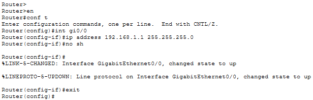
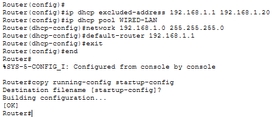

# Lab 02: Small Office Network — DHCP, Wireless Connectivity, and Network Printer

---

## Overview

This lab builds on the basic switching and VLAN concepts introduced in Lab 01 by simulating a small office network in Cisco Packet Tracer.

The network includes three wired PCs, a network printer, a Cisco router, a wireless router, and a laptop connected over Wi-Fi.

The lab focuses on IPv4 addressing, subnetting, router interface configuration, DHCP, wireless security, and end-to-end connectivity testing.

---

## Objectives

By completing this lab, I will demonstrate the ability to:

- Build a small office network topology in Cisco Packet Tracer.
- Connect end devices, switches, and routers using appropriate cables.
- Configure Cisco router interfaces with static IPv4 addresses.
- Configure DHCP pools on a Cisco IOS router.
- Configure a wireless router's SSID and WPA2-Personal security.
- Connect a laptop to a wireless network.
- Assign a static IPv4 address to a network printer.
- Verify addressing and connectivity using `ipconfig` and `ping`.
- Save and verify network device configurations.
- Troubleshoot common addressing and connectivity problems.

---

## Network Topology

### Devices

| Device | Quantity | Purpose |
|---|---:|---|
| Cisco 2911 router | 1 | Routes traffic both LANs and provides DHCP for the wired LAN |
| Cisco 2960 switch | 1 | Connects the wired office devices |
| WRT300N wireless router | 1 | Provides wireless connectivity and DHCP for the wireless LAN |
| PCs | 3 | Wired client devices |
| Network printer | 1 | Printer with a static IPv4 address |
| Laptop | 1 | Wireless client |

### Topology design

The network will use two IPv4 subnets:

1. **Wired LAN:** `192.168.1.0/24`
3. **Wireless LAN:** `192.168.2.0/24`

### Connections

| Source device | Destination device | Cable | Port |
|---|---|---|---|
| PC1 | Switch | Copper straight-through | PC FastEthernet0 → Switch Fa0/1 |
| PC2 | Switch | Copper straight-through | PC FastEthernet0 → Switch Fa0/2 |
| PC3 | Switch | Copper straight-through | PC FastEthernet0 → Switch Fa0/3 |
| Printer | Switch | Copper straight-through | Printer FastEthernet0 → Switch Fa0/4 |
| Switch | Cisco 2911 router | Copper straight-through | Switch GigabitEthernet0/1 → Router GigabitEthernet0/0 |
| Cisco 2911 router | WRT300N | Copper straight-through | Router GigabitEthernet0/1 → WRT300N Internet port |
| Laptop | WRT300N | Wireless | N/A |

---

## Step 1: Add the Devices

1. Added a Cisco 2911 router, Cisco 2960 switch and a WRT300N wireless router.
2. Added three PCs, one printer, and one laptop.
3. Arranged the devices so that the wired LAN and wireless LAN are easy to identify.

---

## Step 2: Connect the Wired Devices

1. Used copper straight-through cables to connect the three PCs and printer to the switch.
2. Connected the switch to the Cisco 2911 router.
3. Connected the Cisco 2911 router's `GigabitEthernet0/1` interface to the WRT300N's **Internet** port.

---

## Step 3: Configure the Cisco Router Interfaces

Accessed the Cisco 2911 router's CLI and configured the wired LAN interface

```text
enable
configure terminal
interface gigabitEthernet 0/0
ip address 192.168.1.1 255.255.255.0
no shutdown
exit
```



**Explanation:**

- `interface gigabitEthernet 0/0` selects the interface connected to the switch.
- `ip address` assigns the router's address on the wired LAN.
- `no shutdown` enables the router.
- `exit` returns to global configuration mode.

> The router's `192.168.1.1` address will serve as the wired clients' default gateway.

---

## Step 4: Configure DHCP for the Wired LAN

Excluded the printer's static address and a small range of addresses reserved for infrastructure.

```text
configure terminal
ip dhcp excluded-address 192.168.1.1 192.168.1.20
```

Created the wired DHCP pool and saved the configuration:

```text
ip dhcp pool WIRED-LAN
network 192.168.1.0 255.255.255.0
default-router 192.168.1.1
exit
end
copy running-config startup-config
```

> When prompted for the destination filename, pressed Enter to accept the default.

**Explanation:**

- `ip dhcp excluded-address` prevents the router from leasing reserved addresses to DHCP clients.
- `ip dhcp pool WIRED-LAN` creates a named DHCP pool.
- `network` specifies the subnet served by the pool.
- `default-router` supplies the default gateway to DHCP clients.

> The excluded range leaves `192.168.1.21` through `192.168.1.254` available for DHCP leases.



### Configure the wired PCs for DHCP

For each PC:

* Opened the PC, selected **Desktop**, opened **IP Configuration**, and selected **DHCP**.
* Confirmed that an IPv4 address, subnet mask, and default gateway were displayed.

> The PCs should receive addresses in `192.168.1.0/24`, excluding the reserved addresses.

### Verify the DHCP configuration

On the Cisco router, ran:

```text
show ip dhcp binding
show ip dhcp pool
show running-config
```

Confirm that the pool exists and that client leases appear after the PCs request DHCP addresses.


---

## Step 5: Configure the Wireless Network

The WRT300N has separate Internet-facing and internal LAN interfaces. A cross over cable was used to connect the WRT300N Internet interface connects to the Cisco 2911 router's Gigabit Ethernet 0/1 interface.

### Configure the SSID, security, and IP address

1. Opened the WRT300N's **GUI** tab and set the SSID as `Office WiFi`.


2. Set the Security Mode to WPA2 Personal and created a password.


3. Opened the **Setup** tab and entered the following values:

| Setting | Value |
|---|---|
| Internet IP address | 192.168.2.1 |
| Subnet mask | 255.255.255.0 |

> The Cisco 2911 will be serving as the network's default gateway.


---

## Step 6: Connect the Laptop to Wi-Fi

### Installed Wireless module

1. Opened the laptop and selected **Physical**.
2. Powered the laptop off.
3. Remove the existing module and replaced with a `WPC300N` module.
5. Powered the laptop back on.

### Connected to Wi-Fi

1. Selected the **Desktop** tab.
2. Clicked the **Connect** tab and refreshed the list of available networks.
3. Connected to `Office-WiFi` and entered the password.


### Verified Laptop is Using DHCP


---

## Step 7: Configure a Static IP Address for the Printer

Assigned a reserved address so that client computers can consistently locate the device.

1. Opened the printer settings and selected **Config**.
2. Selected its wired Ethernet interface: **FastEthernet0**.
3. Configured the following:

| Setting | Value |
|---|---|
| IPv4 address | 192.168.1.10 |
| Subnet mask | 255.255.255.0 |

> The printer's fixed IP is still on the wired LAN's subnet but is kept out of the router’s DHCP pool so the same address won't be given to another device.


---

## Step 8: Verify IPv4 Addressing

On each wired PC, opened **Desktop → Command Prompt** and ran:

```text
ipconfig
```

Confirmed that each PC has:

- An address in `192.168.1.0/24`.
- Subnet mask `255.255.255.0`.
- Default gateway `192.168.1.1`.

---

## Step 9: Test Connectivity

### Test 1: Wired PC to Printer

Pinged the printer from a wired PC's command prompt:


### Test 2: Laptop to Wireless Router


### Test 3: Wireless-to-wired connectivity


---

## Troubleshooting

| Symptom | What to check |
|---|---|
| Router interface is down | Confirm the cable, connected port, and `no shutdown` command |
| PC receives no DHCP address | Check the PC's DHCP setting, router interface status, DHCP pool network, and excluded addresses |
| PC has an incorrect default gateway | Verify the `default-router` statement in the relevant DHCP pool |
| Printer cannot be pinged | Check the printer's static IP, subnet mask, cabling, switch port, and possible address conflicts |
| Laptop cannot see the SSID | Check the SSID, wireless module, wireless settings, and laptop power state |
| Laptop cannot associate with Wi-Fi | Verify the security mode and passphrase on both devices |
| Wireless laptop has no IPv4 address | Confirm the WRT300N LAN IP and DHCP server settings |
| Two devices have the same address | Check the addressing plan, static assignments, and DHCP exclusions |
| Wireless client cannot reach a wired device | Check the WRT300N WAN configuration, NAT behavior, upstream connectivity, and routing design |

---
